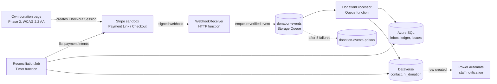

# GiftSync

A donation-to-CRM integration for a **fictional** New Zealand charity, "Harbourlight Trust". Stripe (test mode) sends donation webhooks to an Azure Function (C#/.NET), which creates supporters and donations in Dataverse exactly once, reconciles daily against Stripe, and notifies staff through Power Automate.

> **Work in progress.** See [docs/STATUS.md](docs/STATUS.md) for what is done and what is next.

## Please read first

- **Demo built for learning.** This is a learning and portfolio project, not production software.
- **Stripe test mode only.** No live keys, no real payments, no card data handled by this system.
- **Synthetic data.** All donors, donations and fixtures are made up.
- **Fictional scenario.** The scenario is realistic but is not a description of any real organisation.
- **AI assistance used.** Claude Code (Anthropic) was used to help design and write parts of this project. I review and must be able to explain everything published here.
- **Dynamics 365 apps are not installed.** Only Dataverse and Power Platform are used.
- **No claim of professional C# or Dynamics experience.** I am an experienced Java/Spring Boot backend engineer learning C#/.NET and Dataverse.

## Architecture (sketch)

Donations are created with `POST` against an alternate key on the provider payment id. A duplicate returns HTTP `412` with code `0x80060892`, which is treated as "already processed". Full detail is in [docs/DESIGN.md](docs/DESIGN.md).

## Repository layout

| Path | Purpose |
|---|---|
| `src/GiftSync.Domain` | Value objects and domain events |
| `src/GiftSync.Application` | Ports and the donation-processing use case |
| `src/GiftSync.Infrastructure` | Dataverse, Stripe, persistence and messaging adapters |
| `tests/` | xUnit test projects for each of the above |
| `power-platform/` | Unpacked Dataverse solution source |
| `docs/` | Design document and project status |

## Running locally

Not yet runnable end to end. Secrets are never committed; they go in `dotnet user-secrets` locally and app settings in Azure. Setup instructions will be added once the Functions project exists.

## What this does not show

- Production operations, scaling or support experience.
- Dynamics 365 applications or customisation.
- Live payments, PCI scope or real donor data.

## Documentation

- [docs/DESIGN.md](docs/DESIGN.md): architecture, data model, patterns, failure behaviour, phases and ADRs
- [docs/STATUS.md](docs/STATUS.md): current progress and next steps
