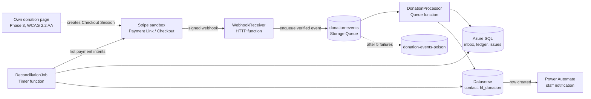
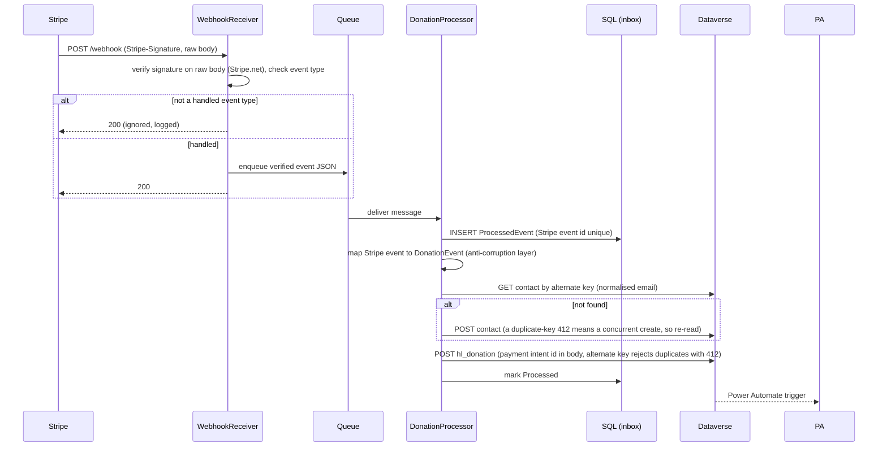

# GiftSync — Design Document

A donation-to-CRM integration for a **fictional** NZ charity ("Harbourlight Trust"). Built as a learning and portfolio project on the Microsoft stack (C#/.NET, Dataverse, Azure, Power Automate), with **Stripe in test mode (sandbox)** as the payment provider.

> **Status:** demo built for learning. Test mode only. Synthetic data only. No real payments, no real donors, no real charity data, no production claims.
> **Honesty note:** this is a realistic scenario for a small charity, built from general patterns. It is not a description of any real organisation's systems.
> **Revision:** v2 replaces the custom provider simulator ("MockPay") with a Stripe sandbox. See ADR-7.

---

## 1. Problem

A mid-sized charity takes gifts through several channels: a website giving form, regular sponsorship payments, payroll giving, event and campaign pages. Each channel reports in its own format and on its own schedule. The payment provider is reliable at taking money. The CRM is where staff look after supporters. The link between them is where things go wrong:

| # | Pain | Consequence |
|---|---|---|
| 1 | **Duplicate supporters.** Same person gives with a different email or spelling. | Giving history split across records; wrong thank-you and appeal targeting. |
| 2 | **Lost or doubled donations.** Providers retry webhooks; networks fail. | One gift becomes two CRM rows, or none. |
| 3 | **Month-end discovery.** Finance finds provider-vs-CRM mismatches weeks later. | Slow, manual fixes. |
| 4 | **Silent lapses.** A failed regular payment is not noticed. | A sponsor quietly drops off with no follow-up. |
| 5 | **Late receipts.** Supporters need receipts to claim the donation tax credit. | More supporter queries; staff time. |

### 1.1 Evidence and assumptions

Each pain point was checked against public sources (Oct 2026). Most sources are vendors or consultancies with a product to sell, so treat them as consistent signals, not independent measurement.

| # | Pain | Status | Sources |
|---|---|---|---|
| 1 | Duplicate supporters | **Documented** (widely reported; vendor-sourced) | [Virtuous](https://virtuous.org/blog/five-ways-your-nonprofit-crm-is-costing-you-too-much-money), [Bloomerang](https://bloomerang.com/blog/crm-cleanup-tasks-for-donor-data) |
| 2 | Lost or doubled donations | **Documented** (providers state delivery is at-least-once; Stripe retries failed deliveries for days) | [AhaSend](https://ahasend.com/blog/why-your-webhook-fired-twice-handling-duplicate-events), [Axonbuild, quoting Stripe docs](https://axonbuild.com/blog/how-to-make-a-webhook-handler-idempotent/). **TODO:** replace with Stripe's own webhooks documentation once checked first-hand. |
| 3 | Month-end discovery | **Partly documented** (manual reconciliation between gateway, CRM and accounting is a recurring theme) | [CLA](https://www.claconnect.com/en/resources/articles/25/nonprofit-month-end-close-strategies), [Cyntexa](https://products.cyntexa.com/blog/donation-challenges-nonprofits-face-in-salesforce/), [Stripe](https://stripe.com/au/resources/more/how-to-handle-recurring-donations-in-nonprofit-payments) |
| 4 | Silent lapses | **Partly documented** (failed recurring payments and unnoticed lapses are widely described; no independent measurement found) | [Stripe](https://stripe.com/resources/more/how-to-handle-recurring-donations-in-nonprofit-payments), [HelpYouSponsor](https://helpyousponsor.com/donations), [Salesforce Trailhead](https://trailhead.salesforce.com/content/learn/modules/opportunity-settings-in-nonprofit-success-pack/manage-recurring-donations-npsp) |
| 5 | Late receipts | **Receipt requirement documented; "late receipts cause supporter queries" is an assumption** | [IRD](https://ird.govt.nz/roles/not-for-profits-and-charities/running-your-nfp/helping-donors-claim-refund), [IRD: claim steps](https://www.ird.govt.nz/tasks/claim-tax-credits-for-donations), [World Vision NZ](https://www.worldvision.org.nz/about/Tax-credit) |

**Assumptions made (not sourced):**
- A charity of this size runs several giving channels that report in different formats.
- Staff typically find provider-vs-CRM mismatches at month-end rather than when they happen.
- Delayed receipts generate supporter queries and staff time.
- The combination of these problems in one small NZ charity on Dynamics 365 is a realistic scenario, not a description of any real organisation.

**Deliberately not used:** vendor-published cost and error-rate figures (for example annual reconciliation cost ranges or "3-8% manual error rate"). They could not be verified. Also, one vendor's claim that a missed payment is the most common reason recurring donors lapse sits uneasily with its own cited figure that affordability is the top reason, so claim only that failed payments are *one* cause.

**Counterpoint:** some organisations auto-merge duplicates, but at least one migration specialist resolves them by review because donor identity errors are costly. That supports the "match, don't merge" decision (ADR-5).

**NZ note:** the NZ donation benefit is a **tax credit** of one third of eligible gifts of $5 or more, claimed by the donor with a receipt that carries the required details. It is not a deduction.

### What GiftSync does

- Receives each donation event from Stripe and applies it to the CRM **once**, even if delivered many times.
- Matches the donor to an existing supporter, or creates one, and **never auto-merges on fuzzy matches**.
- Fails loudly: bad events go to a poison queue with a reason, and can be replayed.
- Notifies staff on each new donation and each problem (Power Automate).
- Reconciles Stripe's records against the CRM daily and records mismatches.

### Non-goals (v1)

Real payments, live-mode keys of any kind, card data handling (Stripe's hosted pages collect it; this system never sees it), refunds and chargebacks (designed for, not built), multi-currency conversion, a production-grade UI, Privacy Act or PCI compliance claims.

---

## 2. Tech stack

| Concern | Choice | Why |
|---|---|---|
| Language/runtime | C# on current .NET LTS (verify the current LTS when you start) | Matches the target platform. |
| Compute | **Azure Functions, isolated worker model** (HTTP + Queue + Timer triggers) | Fits webhook + async processing; free monthly grant on the consumption plan. The old in-process model is being retired, so isolated is the right default. |
| Payment provider | **Stripe sandbox (test mode)**, `Stripe.net` library, Stripe CLI | Real event shapes, signatures, retries and resend tooling. Already familiar, so less learning cost. |
| Messaging | **Azure Storage Queues** (+ automatic poison queue) | Simple, cheap, enough for this volume. Service Bus is the upgrade path (ADR-1). |
| CRM | **Dataverse** via the **Web API (OData v4)** with a typed `HttpClient` | Shows REST fluency; the same API the Power Platform uses. |
| Auth to Dataverse | **Microsoft Entra ID** app registration, client-credentials flow, via `Azure.Identity` | The real friction point of Dataverse integration. |
| Relational store | **Azure SQL Database** (free offer, check current terms) or SQL Server in Docker locally; **EF Core** with migrations | Integration state and the reconciliation ledger. |
| Automation | **Power Automate** (cloud flows) | Staff notifications. |
| Resilience | `Microsoft.Extensions.Http.Resilience` (Polly v8) | Retry with backoff/jitter, honour `Retry-After`, circuit breaker. |
| Observability | Application Insights (set a daily cap) + structured `ILogger` | Correlation by Stripe event id and payment intent id. |
| Secrets | App settings and user-secrets in v1; Key Vault references as a later step | Zero-cost start; upgrade path documented. |
| IaC | **Bicep** (stretch) | Azure-native; keeps the demo reproducible. |
| CI/CD | GitHub Actions (build, test, deploy via OIDC) | Same idea as the pipelines you already know. |
| Tests | xUnit, WireMock.Net (Dataverse stubs), saved Stripe event fixtures, Azurite, Playwright for .NET + `Deque.AxeCore.Playwright` | Covers unit, contract, replay and accessibility. |
| Power Platform ALM | `pac` CLI: export and unpack the Dataverse solution into the repo | Schema as code. |

---

## 3. Architecture

### 3.1 Components



**Source of truth, by design:**
- **Dataverse** is the system of record for supporters and donations (the business view).
- **Azure SQL** holds the integration's own state: which events it has seen, the Stripe-side ledger, reconciliation results.
- **Stripe** is the system of record for the money. Reconciliation compares *independent* sources (Stripe's API vs the CRM). Comparing the pipeline's own copy against itself would prove nothing.

### 3.2 Happy-path sequence



### 3.3 Failure behaviour

| Situation | Behaviour |
|---|---|
| Duplicate webhook delivery (same event id) | Second insert hits the inbox unique key, or Dataverse returns `412`; treated as **already done**, message completed. |
| Duplicate across *different* Stripe event objects for the same payment | The Dataverse alternate key is the **payment intent id**, so the second create returns `412` and is treated as already done. |
| Event type we don't handle | `200`, ignored, logged. Returning an error would make Stripe retry and can get the endpoint disabled. Also configure the endpoint to send only the events you need. |
| Bad signature / stale timestamp | `400`, nothing enqueued, logged without the payload body. |
| `payment_status` not `paid` (for example delayed payment methods) | Ignored in v1, logged. Async success events are a documented stretch. |
| Missing donor email | **Permanent** failure: `Failed` with reason `MissingDonorEmail`, to poison queue immediately. |
| Dataverse `429` (service protection) | Honour `Retry-After`; message retried later. Never hammer. |
| Dataverse `5xx` / network error | Transient: retry with backoff; queue redelivery after visibility timeout. |
| Dataverse `4xx` validation (bad data) | **Permanent:** record `Failed` with reason, move to poison queue immediately. Retrying cannot help. |
| Repeated transient failures | After max dequeue count (default 5) the runtime moves it to `donation-events-poison`. |
| Two events create the same new supporter concurrently | Create is a `POST`; the loser gets `412` with duplicate-key error code `0x80060892` and re-reads the winner. |
| Events arrive out of order | Events are independent; where a payment has several events, a status precedence rule decides (documented, v1 handles `checkout.session.completed` with `paid` only). |
| Stripe sandbox retries a failed delivery | Harmless by design. Check Stripe's documentation for sandbox retry behaviour, which may differ from live mode. |

Delivery is **at-least-once**. The system achieves *exactly-once effect* through idempotent handlers. It does not claim exactly-once delivery.

---

## 4. Patterns used (and why)

| Pattern | Where | Why |
|---|---|---|
| **Ack fast, process async** (queue-based load levelling) | Receiver returns `200` after verify and enqueue | Providers time out and retry on slow webhooks. |
| **Idempotent consumer / inbox** | SQL `ProcessedEvent` unique key + Dataverse alternate key on payment intent id | Retries and duplicates are normal; they must be harmless. Two independent guards at different identity levels (event and payment). |
| **Anti-corruption layer** | Stripe event → domain `DonationEvent` → Dataverse DTO mappers | Stripe's and Dataverse's shapes never leak into the domain (the same idea as Prism's carrier transformations). Swapping provider means writing one new mapper. |
| **Ports and adapters (hexagonal)** | `ICrmGateway`, `IEventInbox`, `IPaymentLedger`, `ISupporterMatcher` | Domain and use cases testable with fakes; Dataverse and Stripe are adapters. |
| **Retry + backoff + jitter, circuit breaker** | Typed `HttpClient` resilience handler | Transient faults are the norm for HTTP integrations. |
| **Dead-letter + replay** | Poison queue + an admin-keyed replay function; Stripe's own `events resend` for upstream replays | Failures are visible and recoverable, not lost. |
| **Result type for expected failures** | Application layer | Exceptions for the unexpected; explicit outcomes for validation and duplicates. |
| **Match, don't merge** | `ISupporterMatcher` | Exact match on normalised email auto-links. Fuzzy matches create a staff review task and never merge automatically. |
| **Fixture-based replay** | Saved real Stripe events in `fixtures/stripe/` | Reproducible duplicate, malformed and out-of-order tests without hitting Stripe. |

**Deliberately not used:** Kafka or Service Bus (overkill at this volume), sagas, microservices, a custom retry loop, CQRS/event sourcing, a custom provider simulator. Each is a real tool; none earns its place here.

---

## 5. Data design

### 5.1 Dataverse (publisher prefix `hl_`)

**`contact`** (standard table) plus:
- `hl_emailnormalised` (string) — **alternate key**. Normalisation: trim + lowercase. Plus-addressing is left as is (ADR-5).

**`hl_donation`**
| Column | Type | Notes |
|---|---|---|
| `hl_providerpaymentid` | string | **Alternate key.** Stripe PaymentIntent id (`pi_...`). The idempotency anchor and the reconciliation join key. |
| `hl_providereventid` | string | Stripe event id (`evt_...`). Audit only, not a key. |
| `hl_providersessionid` | string | Stripe Checkout Session id (`cs_...`). Audit only. |
| `hl_provider` | string | `stripe` in v1. |
| `hl_amount` | Decimal number, precision 2 | Converted from integer minor units with C# `decimal` at the boundary only, never `double`. Chosen over the Currency type to avoid exchange-rate and base-currency setup in a single-currency demo (a real multi-currency Dynamics estate would use Currency). Assumes a two-decimal currency such as NZD. |
| `hl_currency` | string(3) | Uppercased from Stripe's lowercase code. `NZD` in v1. |
| `hl_status` | choice | Succeeded, Failed, Refunded (v1 builds Succeeded). |
| `hl_channel` | choice | Web, Regular, Event. |
| `hl_donatedon` | datetime (UTC) | From the Stripe event or payment time (Unix seconds, UTC). |
| `hl_contactid` | lookup → contact | Bound with `@odata.bind`. |
| `hl_receiptstatus` | choice | Pending, Sent (flow-driven, stretch). |

Alternate keys are indexed by an asynchronous system job, so create them early and wait until they show as Active before testing upserts.

### 5.2 Azure SQL (schema `integration`)

```sql
ProcessedEvent(
  EventId          varchar(64)  PRIMARY KEY,        -- Stripe event id (evt_...)
  EventType        varchar(64)  NOT NULL,
  PaymentIntentId  varchar(64)  NULL,
  PayloadHash      char(64)     NOT NULL,
  Status           varchar(16)  NOT NULL CHECK (Status IN ('Received','Processed','Failed')),
  Attempts         int          NOT NULL DEFAULT 0,
  ReceivedUtc      datetime2    NOT NULL,
  ProcessedUtc     datetime2    NULL,
  LastError        nvarchar(400) NULL)

ProviderTransaction(                                 -- imported from Stripe's API by reconciliation
  PaymentIntentId  varchar(64)  PRIMARY KEY,
  AmountMinor      bigint       NOT NULL CHECK (AmountMinor > 0),
  Currency         char(3)      NOT NULL,
  Status           varchar(24)  NOT NULL,
  OccurredUtc      datetime2    NOT NULL,
  EmailHash        char(64)     NULL,               -- hash, never the raw email
  ImportedUtc      datetime2    NOT NULL)

ReconciliationRun(RunId bigint IDENTITY PRIMARY KEY, StartedUtc datetime2, WindowFromUtc datetime2, WindowToUtc datetime2, IssueCount int)

ReconciliationIssue(
  IssueId          bigint IDENTITY PRIMARY KEY,
  RunId            bigint NOT NULL REFERENCES ReconciliationRun(RunId),
  PaymentIntentId  varchar(64) NOT NULL,
  IssueType        varchar(32) NOT NULL CHECK (IssueType IN
                   ('MissingInCrm','MissingInProvider','AmountMismatch','StatusMismatch')),
  DetectedUtc      datetime2 NOT NULL,
  ResolvedUtc      datetime2 NULL)
```

**Money rule:** amounts are integers in **minor units** (cents) inside the system. Stripe already uses minor units. Never floating point. Convert to Dataverse decimal only at the adapter edge, with an explicit rounding test.

---

## 6. Contracts

### 6.1 Stripe webhook (inbound)

**Handled in v1:** `checkout.session.completed` where `payment_status` is `paid`.
**Later:** `invoice.paid` and `invoice.payment_failed` (recurring giving and lapse detection), refunds.

Fields used from the Checkout Session object (**verify exact names against the current Stripe API reference and your captured fixture**):

| Needed | Stripe field (expected) |
|---|---|
| Event id | `event.id` |
| Event time | `event.created` (Unix seconds, UTC) |
| Payment id (idempotency anchor) | `data.object.payment_intent` |
| Session id | `data.object.id` |
| Amount (minor units) | `data.object.amount_total` |
| Currency | `data.object.currency` (lowercase) |
| Payment state | `data.object.payment_status` |
| Donor email | `data.object.customer_details.email` |
| Donor name | `data.object.customer_details.name` |
| Campaign | Payment Link metadata, if set |

**Verification:** use `Stripe.net`'s `EventUtility.ConstructEvent` on the **raw, unmodified request body**, the `Stripe-Signature` header and the endpoint signing secret. Stripe signs a timestamp plus payload with HMAC-SHA256 and the library enforces a tolerance window. Gotchas to document in the README:
- The **raw body** must reach the verifier untouched (do not parse and re-serialise).
- `stripe listen` prints its **own** signing secret, different from the secret of an endpoint registered in the dashboard. Use the right one for each environment.
- `Stripe.net` is pinned to a Stripe API version; a mismatch with the endpoint's version can make verification throw. Check the version when you add the package.

Keep one unit test that verifies a signature by hand (HMAC over `t.payload`), so you can explain the scheme without the library.

### 6.2 Dataverse calls (Web API)

- **Read contact:** `GET /api/data/v9.2/contacts(hl_emailnormalised='sam.example@example.test')?$select=contactid`
- **Create supporter if absent:** `POST contacts` with `hl_emailnormalised` in the body. A `412` with error code `0x80060892` ("Entity Key … violated") means someone else created it, so re-read by key.
- **Record donation (create-only):** `POST hl_donations` with `hl_providerpaymentid` in the body, plus `"hl_contactid@odata.bind": "/contacts(<guid>)"`. First call returns `204`. A repeat returns `412` with `0x80060892` ("A record with the same value for Provider Payment Id already exists"), which the processor treats as **already processed, which is success**. Verified in the sandbox environment (see ADR-9).
- **Auth:** token scope `https://<org>.crm.dynamics.com/.default`, using an Entra app registration mapped to a Dataverse **application user** with a custom security role limited to the two tables.

**Rule:** donor-supplied details never overwrite existing CRM fields. The CRM is the system of record for supporter data; Stripe's details only fill blanks on create.

### 6.3 Stripe API (reconciliation)

List PaymentIntents for the window (`created` range, auto-paging via `Stripe.net`), then filter to `succeeded` in code. Use a **restricted, read-only API key**. Scope the data by setting metadata on the Payment Link, or by filtering on it, so unrelated sandbox payments do not appear as `MissingInCrm`.

---

## 7. Code structure

```
giftsync/
├─ README.md                      problem, run instructions, honest limits
├─ docs/
│  ├─ DESIGN.md                   this file
│  └─ adr/                        ADR-1 … ADR-8
├─ fixtures/stripe/               captured sandbox events (JSON), secrets stripped
├─ infra/                         main.bicep, parameters (stretch)
├─ power-platform/                unpacked Dataverse solution + exported flows
├─ src/
│  ├─ GiftSync.Domain/            no dependencies
│  │   ├─ Money.cs  EmailAddress.cs  PaymentId.cs
│  │   └─ DonationEvent.cs  Supporter.cs  MatchResult.cs
│  ├─ GiftSync.Application/
│  │   ├─ ProcessDonationEvent.cs        use case
│  │   ├─ ReconcileDonations.cs          use case
│  │   ├─ Ports/ ICrmGateway.cs  IEventInbox.cs  IPaymentLedger.cs  ISupporterMatcher.cs
│  │   └─ Results/ ProcessOutcome.cs      Processed | Duplicate | Ignored | Retryable | Permanent
│  ├─ GiftSync.Infrastructure/
│  │   ├─ Stripe/ StripeEventVerifier.cs  StripeEventMapper.cs  StripePaymentLedger.cs
│  │   ├─ Dataverse/ DataverseClient.cs  DataverseAuth.cs  Mappers/  ODataErrors.cs
│  │   ├─ Persistence/ GiftSyncDbContext.cs  Migrations/
│  │   └─ Messaging/ QueueEnqueuer.cs
│  ├─ GiftSync.Functions/         composition root: Program.cs, DI, options
│  │   ├─ WebhookReceiver.cs  DonationProcessor.cs
│  │   ├─ ReconciliationJob.cs  ReplayPoison.cs
│  │   └─ host.json  local.settings.sample.json
│  └─ DonationPage/               Phase 3: own accessible page that creates a Checkout Session
├─ tests/
│  ├─ GiftSync.Domain.Tests/          Money, email normalisation, matching
│  ├─ GiftSync.Application.Tests/     use cases against fakes
│  ├─ GiftSync.Infrastructure.Tests/  Stripe mapper on fixtures; WireMock.Net: 412, 429+Retry-After, 5xx, malformed
│  └─ GiftSync.E2E.Tests/             Playwright + axe; [Live] tests excluded from CI
└─ .github/workflows/ ci.yml  deploy.yml
```

**Dependency rule:** `Domain ← Application ← Infrastructure ← Functions`. Domain and Application never reference Azure, EF Core, Stripe or HTTP types.

### Key sketches (illustrative, not final)

```csharp
public interface ICrmGateway
{
    Task<SupporterRef?> FindSupporterAsync(EmailAddress email, CancellationToken ct);
    Task<CreateResult> CreateSupporterIfAbsentAsync(NewSupporter s, CancellationToken ct);
    Task<UpsertResult> RecordDonationAsync(DonationRecord d, SupporterRef who, CancellationToken ct); // Created | AlreadyExists
}

public sealed class ProcessDonationEvent(IEventInbox inbox, ICrmGateway crm, ISupporterMatcher matcher)
{
    public async Task<ProcessOutcome> HandleAsync(DonationEvent e, CancellationToken ct)
    {
        if (!await inbox.TryBeginAsync(e.EventId, e.PayloadHash, ct))
            return ProcessOutcome.Duplicate;               // already processed

        var match = await matcher.ResolveAsync(e.Donor, ct);   // Exact | PossibleDuplicate | None
        var who   = match.Supporter ?? await crm.CreateSupporterIfAbsentAsync(e.Donor.ToNew(), ct);

        var result = await crm.RecordDonationAsync(e.ToRecord(), who, ct);   // keyed by PaymentId
        await inbox.CompleteAsync(e.EventId, ct);
        return result == UpsertResult.AlreadyExists ? ProcessOutcome.Duplicate : ProcessOutcome.Processed;
    }
}
```

Mapping from a Stripe event to `DonationEvent` lives in `StripeEventMapper` (Infrastructure). Exceptions are classified at the adapters: `TransientCrmException` (429, 5xx, timeouts) versus `PermanentCrmException` (400-class) and mapping failures such as `MissingDonorEmail`. The function maps them to retry versus poison.

---

## 8. Reconciliation design

Daily timer, window = previous UTC day plus a 24-hour overlap for late events.

1. List Stripe PaymentIntents for the window (paged), keep `succeeded`, and upsert into `ProviderTransaction`.
2. Query Dataverse `hl_donation` for the same window, following `@odata.nextLink` for paging.
3. Compare in memory by `PaymentIntentId` and record issues: `MissingInCrm`, `MissingInProvider`, `AmountMismatch`, `StatusMismatch`.
4. Persist the run and issues in SQL; surface issues to staff via a Dataverse view or a Power Automate notification (stretch).

Because the alternate key is the payment intent id, the pipeline cannot create two rows for one payment. Rows created outside the pipeline (for example manual entry without the key) are caught as `MissingInProvider`.

---

## 9. Power Platform

- **Flow 1 (minimum):** trigger "When a row is added" on `hl_donation`, then a notification with amount, campaign and a link to the supporter. **Test the notification action early:** a bare tenant may have no Exchange or Teams licence, so choose an action that works in your account.
- **Flow 2 (stretch):** scheduled flow flagging `PastDue` regular givers, fed by `invoice.payment_failed`. Use **Stripe test clocks** to simulate time passing in the sandbox.
- **Stretch app:** a small model-driven app with a "Donations needing attention" view.
- **Optional deeper stretch:** a C# Dataverse plugin (`IPlugin`) that rejects non-positive amounts on create. Many Dynamics roles list plugins explicitly; this is the way to earn the claim.
- **Limit:** Dynamics 365 apps cannot be installed in a Power Apps developer environment. This project uses Dataverse and the Power Platform, not D365 Sales or Customer Service. Say so in the README.

---

## 10. Security and privacy

- **Own Stripe sandbox**, separate from any client's. Never mix client keys into this repo.
- **Test mode only.** No live keys anywhere, ever.
- Webhook signature verification on the raw body; secrets differ per environment (local `stripe listen` vs deployed endpoint).
- **Least privilege:** a restricted, read-only Stripe key for reconciliation; the Dataverse application user's role covers only the two tables.
- **No secrets in the repo.** Test API keys and `whsec_` secrets go in user-secrets locally and app settings in Azure. Enable GitHub secret scanning. Fixtures must have secrets and personal data stripped before commit.
- **No PII in logs:** log event id, payment intent id and a hashed email only; never the payload body.
- No card data is handled anywhere in this system. Stripe's hosted pages collect it.
- Synthetic data only. This is not a Privacy Act 2020 or PCI compliance claim.

---

## 11. Accessibility (WCAG 2.2 AA target)

**Scope honestly:** Stripe's hosted Checkout and Payment Link pages are Stripe's, not yours, so they carry no accessibility claim for this project. Phase 3 builds **your own donation page** (amount choice, donor-facing copy, a button that creates a Checkout Session server-side). On that page: visible labels, correct `autocomplete` attributes where fields exist, an error summary with `aria-live`, focus moved to the summary on failure, full keyboard operation, sufficient contrast, no CAPTCHA. Verified by Playwright with `Deque.AxeCore.Playwright` in CI, plus a manual keyboard-only and screen-reader pass. Record what automation cannot catch; axe finds only part of the issues.

---

## 12. Accounts and cost (verify current terms)

Target spend: **NZ$0**, with a possible paid fallback.

| Item | Cost notes |
|---|---|
| Stripe sandbox | Free, test mode. |
| Power Apps Developer Plan (Dataverse, Power Automate) | Free for dev/test, but needs a **work or school account** (personal accounts are not supported). Try the admin account of the Entra tenant created by an Azure free account first. Fallback: a cheap Microsoft 365 plan for one month. |
| Azure Functions, Azure SQL free offer, Azure DevOps (5 users) | Free monthly amounts on an Azure free account. Check current limits. |
| Application Insights | A monthly free ingestion allowance; set a daily cap. |
| Storage Queue | Cents at demo volume. Functions needs a storage account anyway. |
| Key Vault | No free tier; pennies. Optional in v1. |
| Azure OpenAI (Phase 4 stretch) | Could cost real money. Skip or set a hard budget. |

Set an Azure **budget alert** before deploying anything, and keep everything in one resource group so it can be deleted in one step.

---

## 13. Build order

| Phase | Scope | Done when |
|---|---|---|
| **0** (hours 1-3) | Power Apps developer environment, tables and alternate keys, Entra app registration, application user. Stripe CLI logged in; one Payment Link; `stripe listen` running; first `checkout.session.completed` saved as a fixture. Console app reads a contact from Dataverse. | One authenticated Dataverse call returns a row, and you can name the fields carrying email, amount and payment intent id. **If auth takes more than a few hours, reassess.** |
| **1: minimum** (one weekend) | `WebhookReceiver` with `Stripe.net` verification, queue, `DonationProcessor` with idempotent upsert keyed on payment intent id, Flow 1, xUnit tests (mapper on the fixture, handler against fakes), README. | `stripe events resend` of the same event five times creates one donation and notifies staff once. |
| **2** | SQL inbox, reconciliation job against Stripe's API, resilience handler, GitHub Actions, Bicep. | Fault injection (Dataverse 429, 500, 400 via WireMock) behaves as in section 3.3. |
| **3** | Own accessible donation page with Playwright/axe, matching review task, model-driven view, optional recurring giving with test clocks. | axe clean on your page, manual a11y notes written. |
| **4 (optional)** | Dataverse plugin; small AI step (for example classifying free-text supporter notes). | Only after everything above works. |


---

## 14. Architecture decision records (short form)

1. **ADR-1: Storage Queue, not Service Bus.** Volume is tiny and ordering is not needed. Revisit if sessions, topics or strict ordering appear.
2. **ADR-2: Web API over `ServiceClient`.** More transparent for learning and for explaining; `ServiceClient` is a legitimate alternative.
3. **ADR-3: SQL for integration state, Dataverse for business records.** Keeps operational data out of the CRM and enables independent reconciliation.
4. **ADR-4: Minor units everywhere.** Floats and money do not mix.
5. **ADR-5: Match, don't merge.** Exact normalised email only. Plus-addressing is left as is because collapsing it risks false merges.
6. **ADR-6: Secrets in app settings in v1, Key Vault later.** Zero-cost start; the upgrade is documented.
7. **ADR-7: Stripe sandbox instead of a custom simulator.** Real events, signatures and resend tooling for less build time, and a more credible story. Cost: less control over fault injection (mitigated by saved fixtures and WireMock for Dataverse) and the provider's hosted pages are not ours to claim for accessibility.
8. **ADR-8: Idempotency anchored on the payment intent id.** Stripe can send separate event objects for one payment, so the event id alone is not a sufficient key. The event id stays in SQL for audit; the payment intent id is the Dataverse alternate key and the reconciliation join key. The domain stays provider-neutral behind the mapper.
9. **ADR-9: POST create-only, with duplicate-key `412` treated as success, instead of upsert with `If-None-Match: *`.** Microsoft documents `If-None-Match: *` as create-only, but in this environment it returned `404` (error `0x80060891`) on a key that did not exist, while a plain upsert worked. Rather than depend on that behaviour, donations use `POST` and rely on the alternate key's uniqueness: the first call returns `204`, a duplicate returns `412` with `0x80060892`. A replayed event also can never overwrite fields staff have edited since (for example a receipt status), which a plain upsert would do. The processor must branch on the error code, not just the status code, because other `412`s exist.

---

## 15. What this project does and does not demonstrate

**Demonstrates:** building and operating a C#/.NET integration against Dataverse and Stripe, Entra ID auth, webhook verification, idempotency and failure handling, SQL on Azure, Power Automate, CI/CD, and accessibility testing, all new to you on this stack except the Stripe knowledge you already had.

**Does not demonstrate:** years of C# experience, Dynamics 365 customisation, production operation, or anything about a real organisation's systems. Describe it in those terms, and in the interview start from "I built this to learn the stack".